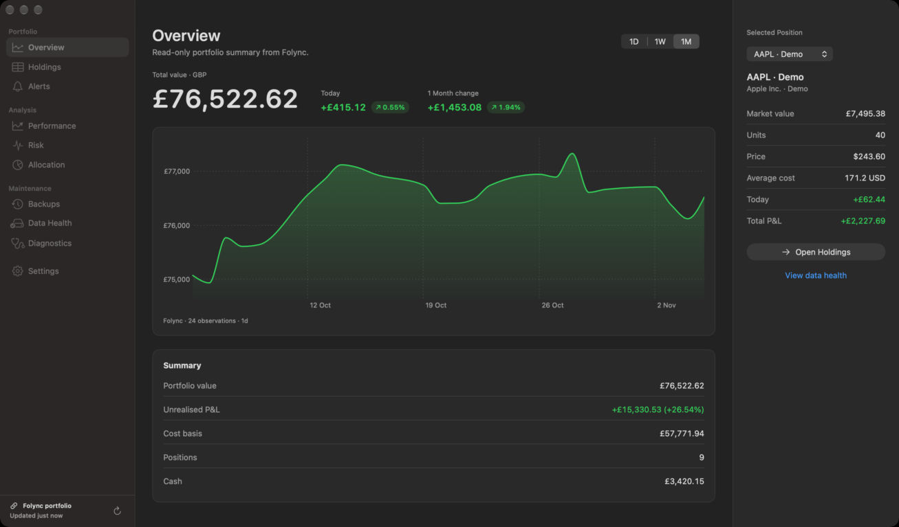

<div align="center">


# StockBar

**Your portfolio, live in the macOS menu bar.**

Holdings, gains, charts, alerts and analytics in a native Mac app, with manual portfolios, Trading 212 and Folync.

[](https://github.com/jayjay181818/StockBar/releases/latest)


[Quick start](#-quick-start) · [Features](#-features) · [User guide](Docs/UserGuide.md) · [FAQ](Docs/FAQ.md) · [Releases](https://github.com/jayjay181818/StockBar/releases)

</div>

<p align="center">
  
  <br>
  <sub>Overview, showing a fictional demo portfolio.</sub>
</p>

## ✨ Highlights

|  |  |
|---|---|
| 📈 **Menu bar first** | Portfolio total and per-stock items in the menu bar, each with a chart popover. |
| 🗂️ **One window for everything** | Overview, Holdings, Alerts, Performance, Risk, Allocation, Backups, Data Health, Diagnostics and Settings in one sidebar. |
| 🏦 **Bring your own source** | Manual holdings and watchlists, read-only Trading 212 broker sync, or a self-hosted Folync portfolio. |
| 🌍 **Multi-currency** | USD, GBP, EUR, JPY, CAD and AUD totals, with UK pence (GBX) handled once and correctly. |
| 🔔 **Alerts** | Price above or below a level, or a percentage move, delivered as macOS notifications. |
| 🧮 **Analytics** | Value at risk, Sharpe and Sortino, drawdowns, correlation, sector allocation and attribution. |
| 🐍 **Sets itself up** | Stockbar installs its own Python for market data. Nothing needs installing first. |
| 🔒 **Private by design** | Data stays on your Mac, credentials stay in the Keychain, and logs are redacted. |

## 🚀 Quick start

**Requirements:** macOS 15.4 or later and a current Xcode.

```bash
git clone https://github.com/jayjay181818/StockBar.git
cd StockBar
bash script/develop.sh run      # build, sign and launch
```

Or open `Stockbar.xcodeproj` in Xcode and run the **Stockbar** scheme.

On first launch, Stockbar asks to **Set Up Stockbar's Python**. Choose **Set Up Automatically**. It needs an internet connection and usually takes under a minute.

> [!NOTE]
> Setup uses `uv` or a Python 3.10+ if one is installed. Otherwise it downloads a pinned release of `uv`, refuses it unless its SHA-256 matches the value built into Stockbar, and keeps it and its Python in Stockbar's own Application Support folder. You can also run it from the terminal with `bash script/setup_python_env.sh`, or do it later from **Settings → Advanced → Python**.

Then open **Holdings → Edit → Add Holding** and enter symbols in Yahoo Finance format (`AAPL`, `VOD.L`, `SHOP.TO`). The [User Guide](Docs/UserGuide.md) covers every screen.

> [!TIP]
> Upgrading from 2.x? Make a backup first (**Backups → Back Up Now**). The first 3.x launch migrates the store in place, and older backups still restore.

## 🧭 Features

### 💼 Portfolio and holdings
- Grouped sidebar: **Portfolio** (Overview, Holdings, Alerts), **Analysis** (Performance, Risk, Allocation), **Maintenance** (Backups, Data Health, Diagnostics) and **Settings**. The footer shows the portfolio source, the last update and a Refresh button.
- The Holdings table has search, summary tiles and an Edit mode. Day P/L and Total P/L switch between amount and percentage when clicked.
- Manual holdings, watchlist-only symbols and broker-linked holdings can coexist.

### 📊 Menu bar
- The portfolio item shows total value and today's change, with a popover chart (Today, 1 Week, 1 Month).
- Per-stock items have their own display modes or a custom template (`{symbol} {price} {arrow}{changePct}`), plus a popover with an optional S&P 500 or FTSE 100 benchmark line.
- Stock items can be limited to times when an external display is connected.

### 🏦 Trading 212 and Folync
- **Trading 212:** read-only API Key + Secret in the Keychain. Test Connection and Preview Import run before anything is linked. Auto-sync runs every 5 minutes by default. Trading is never supported or needed.
- **Folync:** a self-hosted, authoritative read-only portfolio source with optional supplemental history, candles, benchmarks and FX. Local holdings are kept aside and restored when you switch back.

### 📈 Market data and charts
- yfinance is the primary market-data provider. Financial Modeling Prep, Twelve Data and Stooq are fallbacks.
- Interactive Swift Charts for portfolio value, gains and individual symbols, as line or candlestick charts with indicators and benchmark comparisons.

### 🛡️ Reliability
- Automatic daily backups, restore from any backup, and Data Health and Diagnostics screens.
- Atomic, ordered Core Data saves, retry and cooldown for failing symbols, and redacted logs.

<details>
<summary><b>📖 Full feature reference</b></summary>

#### Portfolio And Holdings
- Native Stockbar window with a grouped sidebar: Portfolio (Overview, Holdings, Alerts), Analysis (Performance, Risk, Allocation), Maintenance (Backups, Data Health, Diagnostics) and Settings. The sidebar footer shows the active portfolio source, the last update and a Refresh button.
- Holdings table with search, summary tiles and an Edit mode for visibility, symbol, units, average cost, currency and row actions, plus current price, value, Day P/L and Total P/L.
- Day P/L and Total P/L columns toggle between amount and percentage when clicked.
- Net Value, Total Net Gains and Tracked Symbols summary cards show currency symbols and thousands separators, with USD equivalents in brackets when USD is not the primary display currency.
- Manual holdings, watchlist-only symbols, and broker-linked holdings can coexist.
- UK `.L` holdings and GBX/GBP cost bases are normalized consistently for display and gain calculations.

#### Trading 212 Broker Sync
- Trading 212 can be enabled from Settings → Connections as a broker/portfolio provider.
- Credentials are API Key + API Secret and are stored in macOS Keychain only.
- Supports Live / Real Money and Demo / Paper environments with separated account keys and cache namespaces.
- Account type and label are configurable, including Stocks & Shares ISA, Invest/general, and Unknown/custom.
- Read-only Test Connection and Preview Import flow before linking anything.
- Preview maps Trading 212 provider tickers to canonical instruments and audits manual matches, quantity deltas, and conflicts.
- Link Matched Holdings saves broker links only after user confirmation.
- Linked Trading 212 holdings use broker-provided live position data by default for quantity, current price, value, average cost, and P/L.
- Auto-sync uses one bulk Trading 212 positions/account refresh every 5 minutes by default when enabled (selectable: 30 seconds, 1, 5, 15 or 30 minutes).
- Market-data providers are not called unnecessarily for linked Trading 212 holdings during normal broker sync.
- Optional setting can delete linked manual holdings when the position is removed from Trading 212.
- Trading/order execution is not supported and is never required.

#### Folync Portfolio Source
- Stockbar can use a self-hosted Folync instance as the authoritative read-only source for portfolio holdings, valuation, cash, P/L, freshness, and history.
- Setup is explicit: enter an HTTPS Folync URL and dedicated client token, test the connection, select a portfolio or `All portfolios`, preview it, then activate.
- Folync tokens are stored in macOS Keychain. Plain HTTP is accepted only for `localhost` and `127.0.0.1` development endpoints.
- Stockbar polls Folync conditionally every 60 seconds, keeps the last valid snapshot visible when Folync is offline, and surfaces stale, dirty, rebuilding, or unavailable states.
- Existing local holdings, Trading 212 credentials, broker links, history, and backups remain untouched and can be restored by switching back to the local portfolio.
- Folync-backed financial fields are read-only. Local watchlists, alerts, menu-bar visibility, and UI preferences remain owned by Stockbar.
- An optional Folync Supplemental Data section independently controls historical line charts, candlestick/OHLCV charts, benchmark market data, exchange rates, and whole-series legacy fallback.
- New connections enable only categories that Folync reports supported and ready. Existing Folync configurations migrate with every new category off and never become enabled merely because server readiness changes later.
- Each active series uses current Folync data, then the last valid Folync cache marked stale/partial, then one complete legacy-provider series only when fallback is enabled, otherwise an explicit unavailable state. Folync and legacy points are never spliced into one series.
- Stockbar-only watchlist symbols remain local. Folync-held assets, configured benchmarks, and Folync-allowlisted symbols may use Folync and display their own source, freshness, and coverage status.

#### Market Data And Charts
- yfinance remains the primary general market-data provider.
- Financial Modeling Prep, Twelve Data, and Stooq remain fallback providers for watchlists, manual holdings, historical data, and provider failures.
- Historical fetch priority is configurable from Settings → Connections; live quotes use a fixed provider order.
- Historical charts use the existing market-data system unless their independent Folync line-history or OHLCV route is enabled and usable.
- Interactive Swift Charts views cover portfolio value, portfolio gains, and individual symbol performance.
- Individual stock charts combine stored price snapshots with memory-only live samples. Same-day historical backfills are merged by timestamp, so earlier intraday points are kept even when the symbol already has a current-day sample.
- Benchmark support includes symbols such as `^GSPC` and `^FTSE`.

#### Menu Bar Experience
- Portfolio total can be shown in the macOS menu bar with configurable formatting.
- Individual stock menu bar items can be shown or hidden.
- Stock dropdowns include current values, day/position changes, grouped currency-formatted P/L amounts, and lightweight chart surfaces with memory-only live samples, 2-minute `1D` display buckets, and the latest live endpoint.
- After a relaunch, if memory-only samples are sparse, stock dropdowns request missing 1D symbol and benchmark history, then refresh the open chart when the snapshots arrive.
- The portfolio dropdown `1D` reconstructs the current portfolio over the last 24 hours from current holdings plus available symbol snapshots/live samples, with missing symbol history fetched in the background when coverage is thin.
- Menu bar values update from Trading 212 broker sync for linked holdings, from Folync when it is the portfolio source, and from market-data refreshes for manual/watchlist symbols.
- Stock items can be limited to times when an external display is connected (Settings → Menu Bar → Menu Bar Visibility).

#### Settings
- Embedded Settings section in the main Stockbar window with tabs: General, Menu Bar, Appearance, Connections, Refresh, and Advanced.
- App menu Settings, `Cmd+,`, sidebar Settings, and menu popover Preferences all route to the embedded Settings section.
- Connections includes API key fields for FMP and Twelve Data (with Save & Test and Remove), the Folync portfolio source, fetch priority/fallback order, and Trading 212 broker configuration.
- Trading 212 settings include enable/disable, environment, account type, account label, credential status, Test Connection, Preview Import, Link Matched Holdings, auto-sync settings, and missing-position deletion behavior.
- Sensitive credential fields stay empty after save by design; stored status is shown instead.

#### Reliability, Backups, And Diagnostics
- Backups view for creating, inspecting, and restoring portfolio backups.
- Data Health and Diagnostics views for current portfolio/cache state and log review.
- Core Data persistence for trades, trading info, historical snapshots, and analytics data.
- Broker links are stored separately from market quote/historical caches.
- Broker positions use normalized account + provider ticker identity, so ticker or display-name changes do not create another holding. A versioned startup migration writes and validates a recovery bundle before repairing economically identical alias duplicates; mismatches remain unchanged and quarantined for review.
- Folync schema v2 supplies canonical, display/quote, alias, ISIN, asset, and portfolio identity. Stockbar prefers v2, falls back to v1 for older Folync servers, and keeps historical price series under their original symbols with alias-aware reads.
- Log redaction covers API keys, Trading 212 credentials, auth headers, and sensitive account identifiers.
- Memory pressure handling, cache maintenance, retry/cooldown behavior, and Python subprocess timeouts are built in.

</details>

## 🔌 Data sources

| Source | Provides | Credentials |
|---|---|---|
| **yfinance** (Yahoo Finance) | Quotes, history and OHLC; the primary provider | None |
| **Financial Modeling Prep**, **Twelve Data** | Fallback quotes and history | API key in the Keychain |
| **Stooq** | Fallback quotes and history | None |
| **Trading 212** | Read-only linked broker positions, value and P/L | API Key + Secret in the Keychain |
| **Folync** (self-hosted) | Authoritative portfolio, plus optional history, candles, benchmarks and FX | Client token in the Keychain |

Market-data providers run in Stockbar's own Python. Trading 212 and Folync work without it.

## 🔒 Privacy and security

- Portfolio data is stored locally (Core Data and Application Support). Market-data requests send ticker symbols (with an API key where the provider needs one) to the providers you configure.
- Trading 212, Folync, FMP and Twelve Data credentials live in the macOS Keychain. Credential fields stay empty after saving, and logs redact keys, tokens, auth headers and account identifiers.
- Trading 212 access is read-only. Stockbar never places orders, so don't enable *Orders - Execute*.
- The `uv` download Stockbar's Python setup uses is pinned and checked against a built-in SHA-256.

## 📚 Documentation

| Guide | What's inside |
|---|---|
| 📘 [User Guide](Docs/UserGuide.md) | Every screen, the menu bar, alerts, currencies, connections and shortcuts |
| ❓ [FAQ](Docs/FAQ.md) | Common questions and fixes |
| 🏗️ [Architecture](Docs/Architecture.md) | Components, data flow and source ownership |
| 🛠️ [Development](Docs/Development.md) | Tests, isolation, the acceptance harness and release steps |
| 🧰 [Recovery scripts](Scripts/README.md) | Backup and restore from outside the app |
| 📝 [Changelogs](Changelogs/) | Detailed release notes for every version |

<details>
<summary><b>🏗️ Architecture overview</b></summary>

StockBar uses a hybrid Swift + Python architecture:

- **Swift/AppKit/SwiftUI**: Main app windows, settings, menu bar controllers, portfolio state, Trading 212 provider, broker sync, analytics, diagnostics, and persistence orchestration.
- **Core Data**: Portfolio trades, trading info, historical price snapshots, and portfolio snapshots.
- **Keychain**: Trading 212 credentials, the Folync client token and market-data API keys.
- **Python/yfinance subprocesses**: General market quotes, OHLC data, and historical data fetches when the corresponding Folync category is disabled, unavailable with fallback enabled, or the symbol is local-only.
- **MarketDataProvider path**: yfinance, FMP, Twelve Data, and Stooq for quotes, watchlists, and history.
- **BrokerProvider path**: Trading 212 for broker-linked holdings and live position data.
- **Folync supplemental router**: Category-aware, ETag-backed cached history, benchmark, and USD-base FX reads with no writes to Core Data.

Broker data and market data are intentionally separate. Trading 212 is the source of truth for linked broker positions. Folync may replace a selected market-data category when enabled, while yfinance/FMP/Twelve Data/Stooq continue to serve disabled categories, local-only watchlists, and explicit whole-series fallback.

</details>

<details>
<summary><b>🧑‍💻 Setup guides: manual portfolio, Trading 212 and Python</b></summary>

#### Python For Market Data
Recommended: give Stockbar its own environment with a current Python. It uses `uv` or Python 3.10+ if installed, otherwise downloads a pinned, checksum-verified `uv` for Stockbar's own use:

```bash
bash script/setup_python_env.sh
```

Stockbar picks it up automatically, and the app offers the same setup on first launch. Alternatively, install the pins into another Python 3.10+ and set `pythonInterpreterPath` to it (Apple's `/usr/bin/python3` 3.9 is not supported):

```bash
python3 -m pip install -r Stockbar/Resources/requirements.txt
```

#### Manual Portfolio Setup
1. Launch StockBar.
2. Open the main Stockbar window from the menu bar or app menu.
3. Go to Holdings.
4. Use Add Holding to add or edit manual positions.
5. Use Settings → Connections to configure market-data API keys and provider priority if needed.
6. Use Overview, Performance, Risk, Allocation, Alerts, Backups, Data Health, Diagnostics, and Settings from the sidebar as needed.

#### Trading 212 Setup
1. Open Settings → Connections.
2. Enable Trading 212.
3. Choose Live / Real Money or Demo / Paper.
4. Select the account type and account label, for example `Trading 212 ISA`.
5. Paste the Trading 212 API Key and API Secret, then save credentials to Keychain.
6. Use Test Connection.
7. Use Preview Import to review proposed mappings and conflicts.
8. If all rows are clean manual matches, use Link Matched Holdings.
9. Enable auto-sync if you want linked holdings refreshed from Trading 212 (every 5 minutes by default).

Trading 212 setup is read-only until you explicitly link matched holdings. Previewing does not mutate holdings, backups, historical data, market caches, or Core Data trade rows.

</details>

<details>
<summary><b>📐 How values, charts and refreshes work</b></summary>

#### Holdings
- **Current** shows the latest display price for the position source.
- **Value** is current price multiplied by units.
- **Day P/L** compares current price with previous close.
- **Total P/L** compares current price with normalized average cost.
- Click either P/L column header or value to toggle that column between amount and percentage.
- Amount mode shows signed currency values with symbols and thousands separators, for example `+$12,345.67`.
- Summary cards show the primary currency first and add the USD equivalent in brackets when USD is not the selected display currency, for example `£10,000.00 ($12,700.00)`.
- Linked Trading 212 holdings use broker-provided live position data by default.
- Manual and watchlist-only rows continue through the configured market-data provider chain.

#### Charts And Analytics
- Charts use existing historical data and provider fetches.
- Trading 212 linked holdings still use the market-data provider chain for history unless broker history is added later.
- Main individual-stock charts and stock dropdowns both read from stored symbol snapshots plus memory-only live samples, and refresh as new price data arrives.
- Individual stock dropdown `1D` charts render symbol snapshots and memory-only live samples in 2-minute display buckets, then use the latest live/broker price for the final value.
- Portfolio dropdown `1D` charts value the current displayed holdings across the last 24 hours using available per-symbol snapshots/live samples, skip low-coverage timestamps, and request missing held-symbol history in the background when needed.
- The live chart samples are memory-only and do not increase historical snapshot writes.
- Risk and Allocation views use stored portfolio and historical data.
- Allocation, attribution and risk convert every position into one currency with current exchange rates. Until every position can be valued that way (for example before the first rate refresh), Allocation shows no sector data rather than a mixed or estimated split.
- Holdings with no known sector appear as **Unclassified** and are left out of the diversification score.

#### Backups And Data Health
- Create a backup before large portfolio changes or broker-linking work.
- Data Health shows portfolio/cache state.
- Diagnostics shows logs with redacted sensitive values.

#### Data Sources
- **Market data**: Yahoo Finance/yfinance, FMP, Twelve Data, Stooq.
- **Broker data**: Trading 212 for linked broker positions.
- **Folync supplemental data**: independent toggles for line history, OHLCV, benchmarks, and exchange rates, plus an explicit legacy fallback toggle. These controls require the Folync portfolio source to be active.
- **FMP/Twelve Data keys**: configured in Settings → Connections.
- **Trading 212 credentials**: stored in Keychain only.
- **Fetch priority**: configurable for market-data fallbacks.

#### Refresh Behavior
- Trading 212 linked holdings: one bulk broker sync every 5 minutes by default when enabled.
- General market-data fallback refreshes retain the slower app/provider cadence.
- Folync portfolio snapshots poll every 60 seconds; Folync benchmarks and FX poll every 15 minutes; Folync chart history loads on demand. All Folync routes use ETags.
- An enabled, usable Folync category suppresses its corresponding Python/yfinance/FMP/Twelve Data/Stooq or direct exchange-rate request. Disabling it resumes the existing local pipeline.
- Freshness, partial coverage, stale cache, local fallback, and unavailable states are shown rather than represented as a valid zero.

#### Storage
- **UserDefaults**: non-secret preferences and settings.
- **Keychain**: Trading 212 API Key/API Secret, the Folync client token and FMP/Twelve Data keys.
- **Core Data**: portfolio trades, trading info, historical data, portfolio snapshots.
- **Broker links**: local broker-link records keyed by broker account and instrument identity.
- **Folync supplemental cache**: separate atomic Application Support files keyed by endpoint fingerprint, scope, resource, identity, and range. ETag, payload, and receipt time are stored; bearer tokens are never cached.
- **Caches**: market quote, historical data, broker preview/sync data, and Folync supplemental data remain separate. Folync bars, rates, and benchmark overlays are not written to Core Data.
- Deactivation stops supplemental polling and removes only in-memory Folync overlays. Existing local records and the Folync disk cache remain available.

</details>

## 🩺 Troubleshooting

| Symptom | What to check |
|---|---|
| No market data at all | **Settings → Advanced → Python**: "Not set up" means Stockbar's own Python needs **Set Up**. |
| Some quotes missing | Provider fallback, yfinance or network issues. Confirm the symbol on Yahoo Finance (UK listings need `.L`). |
| FMP `403` | Usually key or plan limits; keys are redacted in logs. |
| Folync "Waiting for Keychain access" | Choose **Always Allow** in the Keychain prompt after an update or rebuild. |
| Menu bar item missing | A full menu bar, the notch or a menu-bar manager may hide it. |

<details>
<summary><b>More troubleshooting</b></summary>

#### Trading 212
- If Test Connection fails, verify environment selection, API Key/API Secret, and Account data permission.
- Metadata permission is recommended for reliable mapping, but preview can still work with lower-confidence mappings when account-position fields are usable.
- Orders - Execute is not needed and should not be enabled for StockBar.
- If a linked holding disappears from Trading 212, StockBar reports it as missing; deletion of the local linked holding is controlled by the Settings option.

#### Market Data
- Missing manual/watchlist quotes usually indicate provider fallback, yfinance, or network issues.
- FMP `403` messages usually indicate key/plan limits; keys are redacted in logs.
- If no market data arrives, check **Settings → Advanced → Python**; "Not set up" means Stockbar's own Python needs **Set Up**.

#### Folync Is "Waiting For Keychain Access" After An Update Or Rebuild
- macOS asks for permission before a rebuilt or re-signed app reads its saved Keychain items. Until you answer the Keychain prompt, the Folync token and API keys can't be read: Folync shows **Waiting for Keychain access**, the token field shows **Checking Keychain…**, exchange rates don't refresh and Allocation stays empty.
- Choose **Always Allow** in the prompt; everything recovers within a minute.
- `bash script/develop.sh run` signs local builds with your Apple Development certificate when one is installed, so the answer is remembered across rebuilds. Without one, builds are signed ad hoc and macOS asks after every rebuild.

#### Menu Bar Item Missing
- A full menu bar, the notch, or a menu-bar manager can hide the portfolio item. Check the manager's hidden section first.
- Stock items also hide when **Only with an external display** is on and no external display is connected.

#### Logs
- Diagnostics shows redacted logs. **Clear Logs** asks for confirmation and offers to export a copy first.
- Log files are stored under `~/Library/Logs/com.stockbar/stockbar.log`.
- Trading 212 sync health can be confirmed by log lines like:

  ```text
  Trading 212 linked sync (auto): Synced 11 linked holdings. Deleted 0. Missing 0. Broker-only 0.
  ```

</details>

## 🛠️ Development

```bash
bash script/develop.sh build          # Debug build, signing disabled, no launch
bash script/develop.sh test           # Full XCTest suite
bash script/develop.sh python-tests   # Offline Python helper tests
bash script/develop.sh checks         # SwiftLint, entitlements, invariants, docs
bash script/develop.sh docs-check     # Documentation links and structure
bash script/develop.sh run            # Signed build and launch
```

See [Docs/Development.md](./Docs/Development.md) for test filters, isolation rules, the acceptance harness, and the release and dependency-update process.

**Contributing**
- Work on a branch and open a pull request into `testing`; CI runs the Python, tooling, lint, build, test and analyze gates on every PR.
- Releases are tagged `vX.Y.Z` on the merged commit.
- Never commit credentials, tokens, private hostnames or personal portfolio data. The [.gitignore](./.gitignore) excludes common secret, key and local-data files.

<details>
<summary><b>🧪 Test coverage</b></summary>

- 542 XCTest tests plus offline Python tests run in CI.
- Portfolio, currency and UK pence/pound tests cover P/L, minor units, missing rates and the UK price-scale repair.
- Persistence tests cover ordered and atomic saves, history loading and bounding, backups and restores (including real backup files), annotations and migrations.
- Trading 212 tests cover auth and redaction, ticker resolution (including London-listed USD ETFs), linking, empty-response safety and account re-keying.
- Folync tests cover sessions, 401/429 backoff, cache corruption, supplemental routing and partial benchmarks.
- Analytics tests cover risk, correlation, attribution, indicators, sector classification and chart reload targeting.
- Test runs use isolated defaults, storage and Keychain items and never touch the real app data.

</details>

## 🗓️ Release history

### 🆕 Version 3.2.0 (current): Stockbar's own Python everywhere
- **Setup**: Settings > Advanced > Python > Set Up works on a Mac with nothing installed. Stockbar downloads a pinned, checksum-verified uv and keeps it and its Python in its own folders.
- **Python**: Apple's `/usr/bin/python3` 3.9 is no longer used. After updating, Stockbar asks once to set up its own Python.
- **Market Data**: yfinance 1.8.0; the pandas warnings on every fetch are gone.
- **Fixes**: Fetch errors say when Stockbar's Python is not set up and point to Set Up.
- See [Changelogs/release_notes_v3.2.0.md](./Changelogs/release_notes_v3.2.0.md).

### Version 3.1.1: Python security update
- **Security**: Stockbar's own Python environment installs urllib3 2.8.0 and requests 2.34.2, which fix eight published vulnerabilities. Rebuild it from Settings > Advanced > Python to pick them up.
- **Fallback**: Apple's `/usr/bin/python3` 3.9 keeps urllib3 1.26.20 and requests 2.32.5, the last versions it can run.
- **Fixes**: The launch-time dependency check reads the interpreter's Python version and checks the pins meant for it.
- See [Changelogs/release_notes_v3.1.1.md](./Changelogs/release_notes_v3.1.1.md).

### Version 3.1.0: Faster market data and Stockbar's own Python
- **Performance**: Persistent Python workers serve quotes, history and OHLC requests without restarting Python each time; live quotes load about a second faster.
- **Python**: Settings > Advanced > Python shows the interpreter in use and can set up Stockbar's own Python 3.13 environment.
- **Interface**: Shared models use Swift Observation, so only views whose data changed redraw. A holding added from the empty Holdings table appears immediately.
- **Fixes**: Settings > Menu Bar no longer crashes under VoiceOver.
- **Development**: The app compiles in Swift 6 language mode.
- See [Changelogs/release_notes_v3.1.0.md](./Changelogs/release_notes_v3.1.0.md).

<details>
<summary><b>Earlier releases (3.0.1 and older)</b></summary>

### Version 3.0.1 - Keychain And Exchange-Rate Fixes
- **Keychain**: Folync says when it is waiting for Keychain access, and a pending Keychain prompt no longer stalls Folync supplemental data.
- **Exchange Rates**: A failed rate fetch is retried after five minutes instead of an hour.
- **Logs**: Routine history trimming no longer logs a warning.
- **Development**: Local builds sign with a stable development identity when one is available, so Keychain access survives rebuilds.
- See [Changelogs/release_notes_v3.0.1.md](./Changelogs/release_notes_v3.0.1.md).

### Version 3.0.0 - Reliability And Data-Safety Release
- **Data Safety**: Stored price history is loaded and kept; recalculations never replace recorded snapshots; saves are atomic and ordered; a failed startup load can no longer lead to the stored portfolio being overwritten.
- **Crash And Broker Fixes**: Duplicate symbols no longer crash the app; an empty Trading 212 response no longer deletes linked holdings; account-label or key changes keep broker links.
- **Backups**: Safer restores, Folync-aware backups, more fields preserved, newest five always kept.
- **Folync**: Shared 401/429 backoff, corrupt-cache recovery, isolated Test Connection and Preview.
- **Correct Numbers**: Missing exchange rates no longer break totals; correct UK, ZAc and ILA minor-unit handling; single-currency analytics; fixed risk, indicator and attribution maths; honest range changes.
- **Interface**: Redesigned main window and settings, confirmations for destructive actions, removable API keys, accessibility and Reduce Motion support.
- **Upgrade**: Stored data is migrated on first launch; back up first.
- See [Changelogs/release_notes_v3.0.0.md](./Changelogs/release_notes_v3.0.0.md).

### Version 2.4.4 - Trading 212 Broker Valuation Accuracy
- **Broker Account Value**: Linked Trading 212 portfolios use the broker account value, including cash, for Net Value and portfolio summaries while a matching valuation snapshot is fresh.
- **Broker P/L**: Linked position and portfolio Total P/L use Trading 212 unrealised P/L and cost data when available; Day P/L retains Stockbar's previous-close calculation.
- **Currency Safety**: Broker values are converted from the account currency without revaluing broker-provided GBP positions through the local USD path, with GBX/GBP normalization preserved.
- **Safe Fallbacks**: Stale, invalid, missing, or account-mismatched broker snapshots fall back to the existing local portfolio calculations.
- **Resilient FX**: When live exchange-rate refresh fails, Stockbar activates the latest saved historical USD rate snapshot before relying on hard-coded fallback rates.
- See [Changelogs/release_notes_v2.4.4.md](./Changelogs/release_notes_v2.4.4.md).

### Version 2.4.3 - Embedded Settings & Live Menu Graph Polish
- **Embedded Settings**: Moved Settings into the main Stockbar window as a first-class sidebar destination.
- **Unified Settings Routing**: App menu Settings, `Cmd+,`, sidebar Settings, and menu popover Preferences now open the embedded Settings section instead of a separate popout.
- **Menu Dropdown Graphs**: `1D` stock dropdown charts use symbol snapshots/live samples, while portfolio dropdown charts reconstruct the current portfolio over the last 24 hours from current holdings plus available symbol snapshots/live samples.
- **Chart Backfill Continuity**: Main individual-stock charts now use the same stored-plus-live symbol data source as dropdown charts, and same-day historical backfills merge by timestamp instead of being discarded as duplicate days.
- **Menu Relaunch Recovery**: Sparse stock and benchmark dropdown charts now request missing history after app relaunch and refresh the open chart when snapshots arrive.
- **Portfolio 1D Coverage**: Missing held-symbol history is requested in the background when coverage is thin; low-coverage timestamps are skipped and no historical snapshot write cadence changes are made.
- **Currency Formatting Polish**: Summary cards, Holdings P/L amount mode, and menu dropdown P/L values now show currency symbols plus comma separators, with USD equivalents in brackets for non-USD summary cards.
- **Holdings Window Polish**: The main window opens within the visible screen and the Holdings table remains reachable on narrower widths.
- **Refresh Safety**: Historical snapshot cadence, provider fallback cadence, holdings, backups, and cache keys are unchanged.
- See [Changelogs/release_notes_v2.4.3.md](./Changelogs/release_notes_v2.4.3.md).

### Version 2.4.2 - Trading 212 Broker Sync & Modern UI
- **Trading 212 Broker Provider**: Added read-only connection testing, import preview, manual-match audit, broker-link persistence, and linked holding sync.
- **Secure Credentials**: Trading 212 API Key/API Secret are stored in Keychain; logs redact credentials, auth headers, account identifiers, and sensitive payload fields.
- **Broker-Primary Linked Holdings**: Linked Trading 212 holdings use broker-provided live position data by default for quantity, price, value, average cost, and P/L.
- **30-Second Broker Sync** (2.4.2; later releases default to 5 minutes): Trading 212 sync used one bulk positions refresh every 30 seconds without changing the slower market-data fallback cadence.
- **ISA/Account Labelling**: Users can configure account type and account label, including Stocks & Shares ISA.
- **Safe Linking**: Preview/import does not mutate holdings until explicit linking; broker links are keyed by broker account and instrument identity.
- **Modern Stockbar Window**: Added the first-class sidebar UI for Holdings, Charts, Risk, Allocation, Alerts, Backups, Data Health, and Diagnostics.
- **Modern Settings Window**: Added General, Menu Bar, Appearance, Data Sources, Refresh, and Advanced tabs.
- **Holdings P/L**: Added Total P/L beside Day P/L with amount/percentage toggles.
- **Fixes**: Corrected Trading 212 LSE pence/GBP cost-basis normalization and HIMS provider alias mapping.
- See [Changelogs/release_notes_v2.4.2.md](./Changelogs/release_notes_v2.4.2.md).

### Version 2.4.1 - Reliability & Portfolio Popover Release
- **Portfolio Popover**: Modernized the portfolio total popover and shared menu chart components.
- **Data Safety**: Added Core Data recovery safeguards and hardened backup, restore, import, and export flows.
- **Logging Safety**: Added canonical secret redaction across app and Python subprocess logs.
- **Responsiveness**: Moved OHLC/Python subprocess work off the UI actor with async pipe reads and timeouts.
- **Test Coverage**: Restored full Xcode test target membership and added reliability regression coverage.

### Version 2.4.0 - Portfolio Popover & Data Provider Improvements
- **Popover Improvements**: Fixed menu popover anchoring, footer layout, dismissal behavior, and updated timestamp formatting.
- **Charts & Benchmarks**: Added benchmark overlays for `^GSPC` and `^FTSE` with range-aware chart changes.
- **Menu Bar Stability**: Reused status items across refreshes to reduce menu bar reshuffling and formatting loss.
- **Data Providers**: Added symbol aliases, improved UK symbol handling, and expanded quote/historical fallbacks.
- **Persistence Fixes**: Restored deep-edit persistence and prevented benchmark helpers from persisting as user trades.

### Previous Versions
- See [Changelogs/](./Changelogs/) for detailed release notes.

</details>

---

<div align="center">

Built with Swift, SwiftUI, AppKit, Core Data and Python/yfinance.

[Releases](https://github.com/jayjay181818/StockBar/releases) · [Issues](https://github.com/jayjay181818/StockBar/issues) · [Changelogs](./Changelogs/)

<sub>Last updated: November 5, 2026 · Version 3.2.0</sub>

</div>
